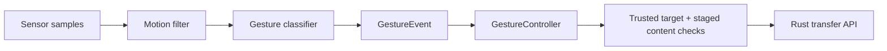

# Motion Handoff

The existing classifier maps positive Y to SEND, negative Y to RECEIVE and
twist to CANCEL. This iteration connects the semantic event stream to the
real `GestureController` for SEND and CANCEL during an explicit visible
gesture session. RECEIVE is deliberately rejected until a real Windows
content-provider request path exists; it must not report mock success.

The gesture controller still requires a trusted target and staged content for
SEND, and an active transfer for CANCEL. Multiple trusted Windows targets are
not selected arbitrarily.
