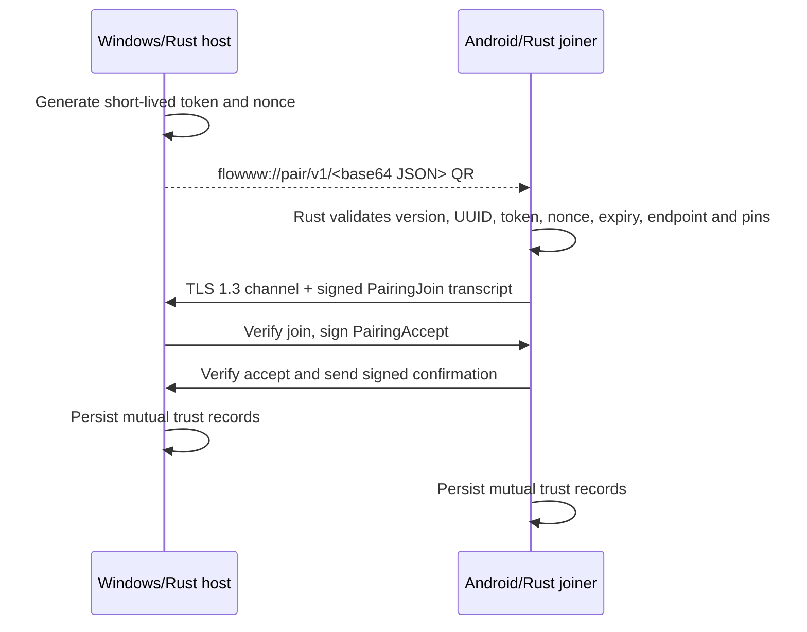

# Pairing Protocol (Current Rust Implementation)

The URI contains public identity metadata and a one-time token; it does not
contain private keys. The Rust security crate owns parsing, validation,
transcript construction, Ed25519 signatures, expiration and replay checks.
Android's parser is UX-level validation only and must not establish trust.

Normal sessions use TLS 1.3 with pinned certificate fingerprints and a second
Ed25519 identity/transcript check. Discovery metadata is never trusted.

## Required negative cases

Expired, malformed, tampered, replayed, wrong-session, wrong-device and
cancelled invitations must fail before trust persistence. Existing Rust tests
cover malformed/replayed tokens, tampered joins and full transcript
verification; Android↔Windows physical evidence is still missing.
