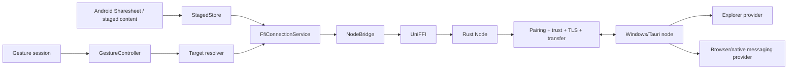

# Phase E.2/E.3 Implementation Plan

**Branch:** `feat/phase-e-cross-device-reliability`  
**Scope:** secure platform storage, real platform content adapters, motion
handoff, background lifecycle and distributable builds.

## Current execution graph

## Audited status

### Implemented and host-validated

- Rust owns pairing, trust, TLS, authorization, transfer state, chunking,
  resume and SHA-256 verification.
- Android UniFFI node, pairing, discovery, transfer event and incoming-offer
  adapters are wired.
- Android QR scanner and Sharesheet staging exist.
- Windows Tauri node initialization, event forwarding, offer response and
  ordinary cancellation commands exist.
- Android node start/stop is serialized and staged blobs are below the Rust
  sandbox.
- Rust and Android host/unit validation has passed in prior iterations.

### Not complete

- Android identity/TLS secret material is still file-backed by Rust; Android
  Keystore is not connected to the Rust node.
- Windows identity/TLS secret material is still file-backed; DPAPI is not
  connected.
- Android receive approval does not yet select a user-approved destination or
  expose a complete ContentResolver receive path.
- The gesture controller is not constructed by the production app graph and
  has no RECEIVE content-provider path.
- Android foreground service exists only as a basic transfer notification
  service; gesture-session ownership and restart behavior are incomplete.
- Windows Native Messaging active-tab extraction remains unavailable in the
  host implementation.
- Windows installer and signed Android release artifact have not been
  produced or validated.
- No physical Android phone/laptop LAN acceptance has been performed.

## Ordered implementation stages

1. **Platform storage boundary**
   - Add a platform secret-store abstraction to Rust.
   - Keep protocol code independent of storage implementation.
   - Add Windows DPAPI implementation and an Android Keystore bridge design
     that never puts private keys in DTOs.
   - Define corruption, reset and backup/restore behavior.

2. **Android content and receive destination**
   - Preserve source URI grants while staged.
   - Add a controlled destination abstraction using SAF.
   - Stream received bytes into a temporary destination, verify, then commit.
   - Reconcile received records after process death.

3. **Windows providers**
   - Make Explorer and browser provider results typed and explicit.
   - Connect Native Messaging requests to the actual extension protocol.
   - Keep clipboard staging opt-in.

4. **Motion handoff**
   - Add one application-owned gesture session controller.
   - Resolve only a configured trusted target.
   - Route SEND and CANCEL through the existing FFI connection service.
   - Implement RECEIVE only through an explicit Windows provider and approval
     policy.

5. **Background lifecycle**
   - Start a user-visible foreground session only while enabled.
   - Register/unregister sensors deterministically.
   - Add notification and process-recreation recovery.

6. **Builds and CI**
   - Add release APK metadata/checksum generation.
   - Add Windows release/installer packaging on a native Windows runner.
   - Upload unsigned artifacts only when signing secrets are unavailable.

7. **Acceptance**
   - Run host integration, emulator/instrumentation, Windows install and real
     Android↔Windows LAN tests separately.
   - Report physical evidence only for tests actually performed.

## Release gate

The branch is not release-ready until platform key protection, real Android
receiving, motion lifecycle, Windows packaging and physical cross-device tests
have evidence. Compilation alone does not satisfy this gate.
