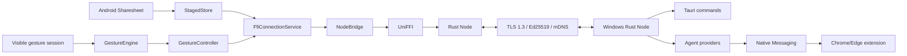

# Phase E.4 Audit

**Branch:** `feat/phase-e-cross-device-reliability`  
**Audit scope:** current repository after commits `0f26e32`, `4ec8797` and
`8578d4f`, plus the preceding Phase E work.

## Architecture and real execution paths

### Android SEND path

The Sharesheet stages content in `StagedStore`. The visible gesture session
emits a semantic event. `GestureController` now checks that content is staged,
that a trusted Windows target is unambiguous, and then calls
`FfiConnectionService`. The connection service calls the Rust node through
UniFFI. This path is host/compile validated but not physically tested.

### Android RECEIVE path

The classifier and controller receive the event, but the controller
deliberately rejects RECEIVE because no authenticated Windows content-provider
request protocol is connected. There is no fabricated receive success.

### Windows path

Tauri initializes a Rust node, forwards selected node events, exposes pairing,
history, cancellation and pending-offer responses. The agent and Native
Messaging modules exist, but `get_active_tab` and related Native Messaging
handlers still return `NOT_IMPLEMENTED` in the runtime path.

## Status by area

| Area | Status | Evidence |
|---|---|---|
| Rust identity persistence | Implemented, file-backed | Rust tests; no DPAPI/Keystore |
| Pairing/trust | Implemented in Rust | Rust pairing/FFI tests |
| TLS/mDNS | Implemented in Rust | Rust network/discovery tests |
| Android UniFFI node | Connected | Android compile/unit tests |
| Android SEND gesture | Connected to real controller | Android compile/unit tests; no device |
| Android RECEIVE gesture | Intentionally blocked | No Windows request provider |
| Android incoming files | Node download path only | No SAF destination integration |
| Windows Explorer provider | Partial | Source inspection; runtime unverified |
| Windows browser provider | Stubbed at Native Messaging boundary | `get_active_tab` returns error |
| Windows background agent | Partial | `cargo check`; no clean install |
| Android release APK | Locally assembled and signed | APK inspection; no install test |
| Windows installer | CI-configured, not locally built | Local MinGW linker failure |
| Physical cross-device | Missing | No phone/laptop session performed |

## Security findings

1. Rust identity and TLS keys remain file-backed. Android Keystore and Windows
   DPAPI are not connected to the Rust storage abstraction.
2. Android receive destinations are not yet user-selected SAF destinations.
3. Native Messaging allowlist/registration is scaffolded but not installed
   and exercised on Chrome or Edge.
4. The Android foreground service currently supports transfer notification,
   not a complete background gesture-session owner.

## Reliability finding addressed in this increment

`flowww-node::Node::snapshot()` used a non-blocking `try_read()` for peer
state. Concurrent discovery could cause normal polling to fail with
`peer state is busy`, which surfaced as an intermittent FFI integration-test
failure. The snapshot now waits up to 250 ms before returning a genuine error.

## Prioritized remaining work

1. Add platform secret-store adapters and explicit reset/re-pair behavior.
2. Add Android SAF receive destination and verified commit path.
3. Define authenticated content-request/content-offer protocol messages.
4. Implement Windows Explorer/browser provider request handling.
5. Move the gesture session into a user-visible foreground-service lifecycle.
6. Add native MSVC build, installer, Native Messaging registration and clean
   installation validation.
7. Execute Android↔Windows physical acceptance and resource measurements.
