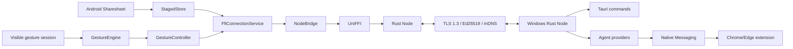

# Phase E.4 Audit

**Branch:** `feat/phase-e-cross-device-reliability`  
**Audit scope:** current repository after commits `0f26e32`, `4ec8797` and
`8578d4f`, plus the preceding Phase E work.

## Architecture and real execution paths

### Android SEND path

The Sharesheet stages content in `StagedStore`. The visible gesture session
emits a semantic event. `GestureController` now checks that content is staged,
that a trusted Windows target is unambiguous, and then calls
`FfiConnectionService`. The connection service calls the Rust node through
UniFFI. This path is host/compile validated but not physically tested.

### Android RECEIVE path

The classifier and controller receive the event, but the controller
deliberately rejects RECEIVE because no authenticated Windows content-provider
request protocol is connected. There is no fabricated receive success.

### Windows path

Tauri initializes a Rust node, forwards selected node events, exposes pairing,
history, cancellation and pending-offer responses. The agent and Native
Messaging modules exist, but `get_active_tab` and related Native Messaging
handlers still return `NOT_IMPLEMENTED` in the runtime path.

## Status by area

| Area | Status | Evidence |
|---|---|---|
| Rust identity persistence | Implemented, platform-protected | DPAPI (Windows), Keystore (Android); Rust tests |
| Pairing/trust | Implemented in Rust | Rust pairing/FFI tests |
| TLS/mDNS | Implemented in Rust | Rust network/discovery tests |
| Android UniFFI node | Connected | Android compile/unit tests |
| Android SEND gesture | Connected to real controller | Android compile/unit tests; no device |
| Android RECEIVE gesture | Real via content-provider path | FFI requestContent wired; GestureController calls it; approval required |
| Android incoming files | SAF receive + verified commit | `d4811fb`; 21 JVM tests; digest-aware resolution; retry budget |
| Windows Explorer provider | Registered in agent | `lifecycle.rs` registers clipboard + explorer; `cargo check` green |
| Windows browser provider | Real `get_active_tab` | Native Messaging host stores/reports tab; manifest + registration script |
| Windows background agent | Wired, `cargo check` green | ContentSource + IPC RequestContent; no MSVC install yet |
| Android release APK | Locally assembled and signed | APK inspection; no install test |
| Windows installer | CI-configured, not locally built | Local MinGW linker failure |
| Physical cross-device | Missing | No phone/laptop session performed |

## Security findings

1. Platform secret stores connected: Android Keystore and Windows DPAPI
   protect identity and TLS keys at rest (see PLATFORM_KEY_STORAGE.md).
2. Android receive destinations are user-selected SAF folders with verified
   SHA-256 commit (see FILE_RECEIVING.md).
3. Native Messaging allowlist/registration scaffolded: manifest JSON and
   PowerShell registration script provided; not installed/exercised on Chrome
   or Edge.
4. The Android foreground service supports transfer notification; background
   gesture-session ownership/restart is not yet implemented.

## Reliability finding addressed in this increment

`flowww-node::Node::snapshot()` used a non-blocking `try_read()` for peer
state. Concurrent discovery could cause normal polling to fail with
`peer state is busy`, which surfaced as an intermittent FFI integration-test
failure. The snapshot now waits up to 250 ms before returning a genuine error.

## Prioritized remaining work

1. Move the gesture session into a user-visible foreground-service lifecycle
   with process-death restart (P6).
2. Harden the Windows background agent (P8).
3. Add native MSVC build, installer, and clean-installation validation.
4. Publish release APK + checksums; validate `phase-e.yml` CI.
5. Execute Android↔Windows physical acceptance and resource measurements.
