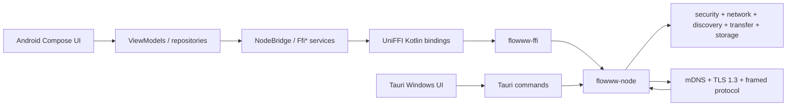

# Flowww Phase E Audit

**Branch:** `feat/phase-e-cross-device-reliability`  
**Audit basis:** repository inspection on the current branch; compilation and
host-side tests are reported separately from physical-device validation.

## 1. Existing architecture

Rust is the intended authority for identity, trust, pairing, network sessions,
offers, transfer records and integrity. Android and Tauri are adapters, but the
current adapters do not yet provide complete runtime parity.

## 2. Implemented components

### Rust

- Workspace crates exist for core models, protocol framing, security, storage,
  mDNS discovery, TLS/network sessions, transfers, spatial routing, node
  orchestration and UniFFI.
- `flowww-node` starts an identity, persistent TLS certificate, SQLite store,
  trusted listener and optional mDNS discovery.
- Ed25519 identities, signed pairing transcripts, one-time QR tokens,
  expiration checks and replay guards are implemented in Rust.
- TLS configuration restricts normal sessions to TLS 1.3 and pins peer
  certificate fingerprints through the trust store.
- File transfers stream bounded chunks, persist partial files, resume on a
  chunk boundary and verify SHA-256 before atomic rename.
- Incoming offers default to explicit approval (`auto_accept = false`).
- FFI exposes lifecycle, pairing, discovery, trust, offers, transfer history,
  status, cancellation and event callbacks.
- Rust tests include loopback transfers, pairing, cancellation/integrity,
  FFI flows, multi-device stress and spatial scenarios.

### Android

- Generated UniFFI Kotlin bindings and arm64-v8a/x86_64 native libraries are
  produced by `scripts/build_rust_android.ps1`.
- `NodeBridge` owns one process-local node, registers callbacks before start,
  forwards events to `SharedFlow`, and holds a multicast lock.
- FFI-backed connection, pairing and discovery services exist.
- Transfer events are mapped into the Android transfer repository.
- Pending incoming offers are exposed through `FfiTransfersBridge` and the UI
  has approve/reject actions.
- QR scanning uses ZXing with runtime camera permission handling.
- App container wiring starts the Rust node and the transfer event bridge.

### Windows/Tauri

- Tauri commands initialize one in-process `flowww-node`, forward peer,
  pairing and transfer events, expose trust/history/status and support pairing.
- A background agent, local IPC server, provider registry and Native Messaging
  host modules exist.
- Desktop Rust compilation previously passed, but no Windows runtime session
  has been executed in this environment.

## 3. Stubbed or incomplete components

- `ConnectionServiceImpl` and `PairingServiceImpl` remain in source and tests,
  although production container wiring now selects FFI implementations.
- Several Android screens, tests and documentation still describe the old
  standalone/stub build and should be updated to avoid misleading status.
- Android received-file destination selection and ContentResolver streaming are
  not connected to the Rust receive path. Rust currently receives to the node
  download directory.
- Android staged blob references are filesystem paths under
  `filesDir/staged_store/blobs`; Rust FFI sandboxing accepts only paths below
  `filesDir/flowww_node`. Real Android file sends therefore fail until the
  staging boundary is corrected.
- Desktop event forwarding currently ignores `OfferReceived` and
  `OfferClosed`; desktop approval commands are not exposed in the inspected
  Tauri command set.
- Desktop `cancel_transfer` calls only `cancel_spatial`, so ordinary transfers
  are not cancellable through that command.
- Native Messaging `get_active_tab` still returns a deliberate “not connected”
  error in the host module; browser runtime integration is incomplete.
- Gesture recognition and the `GestureController` are not wired to the real
  FFI transfer lifecycle.
- No CI workflow files are present under `.github/workflows`.

## 4. Incomplete integration points

### Android execution path

1. Compose action stages content through `StagedStore`.
2. `StagedContentViewModel` calls `ConnectionService`.
3. `FfiConnectionService` chooses `sendText`, `sendUrl` or `sendFile`.
4. `NodeBridge` calls synchronous UniFFI methods on `Dispatchers.IO`.
5. Rust creates an offer, opens the pinned TLS session, streams chunks and
   emits `TransferUpdated` records.
6. `FfiTransfersBridge` maps records into `TransferHistoryStore`.

The path is structurally connected, but file path sandbox mismatch, event
subscription timing, no Android foreground-transfer orchestration, and no
real receive destination make it incomplete for cross-device use.

### Windows execution path

1. Tauri startup invokes `initialize_node`.
2. A Rust node is started with `NodeConfig::default()`.
3. Tauri commands call node pairing/discovery/history/send APIs.
4. `emit_node_events` forwards selected node events to the web UI.

The node path is real Rust, but offer UI, ordinary transfer cancellation,
runtime packaging, firewall/startup behavior and Native Messaging are not
verified as a complete Windows product path.

## 5. Security gaps and risks

- `FileSecretStore` stores the Ed25519 secret as base64 JSON. It restricts
  Unix permissions, but Windows does not use DPAPI and Android does not use
  Android Keystore. This does not meet the Phase E platform-storage
  requirement.
- `DeviceTls` persists the private TLS key as an ordinary DER file. The same
  platform-protection concern applies.
- Pairing payload fields are validated and the Rust handshake verifies signed
  transcripts, but Android’s local parser is still a separate minimal parser
  used for UX validation. The Rust path must remain the only authority.
- Discovery metadata is correctly treated as untrusted, but Android UI status
  does not yet expose a complete authenticated connected/disconnected model.
- Tauri public error mapping is intentionally generic, but some lower-level
  command paths still return raw strings and need a consistent redaction audit.
- Native IPC authentication and Windows OS registration need runtime review.

## 6. Lifecycle issues

- `NodeBridge.start()` checks `isRunning()` and then adds a listener/starts the
  node without a mutex. Concurrent callers can race and register duplicate
  listeners or observe `AlreadyStarted`.
- Stop can race with a start or a service call; lifecycle ownership needs a
  serialized state machine.
- Android process recreation reconstructs the node from the same directory,
  but foreground-service ownership, restart policy and transfer recovery are
  not implemented end-to-end.
- Rust event callbacks are removed on `NodeBridge.stop()`, but duplicate bridge
  starts and multiple transfer collectors are not guarded.
- Tauri initialization has a mutex and double-check, but event forwarder and
  node shutdown behavior still require Windows runtime testing.

## 7. Cross-platform compatibility risks

- Android Rust paths and Android content URIs are not interchangeable.
- Android native libraries and generated bindings are build artifacts/source
  respectively, but binding regeneration consistency is not checked in CI.
- File permissions and secret protection differ materially between Unix,
  Windows and Android.
- mDNS multicast behavior varies by Android Wi-Fi power management and Windows
  firewall configuration.
- Tauri commands and Android FFI expose different offer/event surfaces.
- Desktop uses a default data directory while Android supplies app-private
  directories; restart and migration behavior must be tested separately.

## 8. Missing tests

- Identity persistence, corruption recovery and secure platform storage.
- Concurrent node start/stop and duplicate event subscription behavior.
- Android bridge lifecycle and process recreation.
- Android ContentResolver streaming and real destination selection.
- Desktop ordinary transfer cancellation and incoming offer approval.
- Cross-platform Android↔Windows pairing, discovery and bidirectional transfer.
- Network interruption/reconnect and resume across process restarts.
- Windows agent, tray, startup registration, firewall and Native Messaging
  runtime behavior.
- CI validation for Rust, Android and Windows.
- Physical Android and Windows acceptance tests.

## 9. Prioritized implementation plan

1. **Stage E1 — lifecycle and identity:** serialize Android node ownership,
   add restart/corruption tests, and define platform-backed secret storage
   adapters without changing Rust protocol semantics.
2. **Stage E2 — pairing/trust evidence:** add negative pairing tests and verify
   both endpoints persist/reload trust after restart.
3. **Stage E3 — discovery:** reconcile peer snapshots/events, stale-peer
   removal, reconnect behavior and Android UI state.
4. **Stage E4 — transfers:** fix Android content staging, receive destinations,
   ordinary desktop cancellation, desktop offers, progress/recovery and
   multi-file semantics.
5. **Stage E5 — runtime hardening:** foreground service, process recreation,
   Windows agent/Native Messaging/runtime packaging and network permissions.
6. **Stage E6 — motion:** connect gestures only after real transfer paths are
   tested, preserving explicit approval and manual controls.
7. **Stage E7 — CI and documentation:** add workflows, integration tests,
   protocol/state-transition docs, security review and a physical test matrix.

## Evidence status at audit time

| Area | Current evidence | Status |
|---|---|---|
| Rust workspace | Source inspection; prior host checks | Partially verified |
| Rust transfer protocol | Existing host tests in repository | Host-tested, cross-device unverified |
| UniFFI | Generated bindings and prior Android compile | Compile-verified |
| Android FFI path | Source connected; no device run | Not runtime-verified |
| Android QR | UI/dependency present; no physical scan | Not physically verified |
| Windows node | Tauri source and prior cargo check | Runtime unverified |
| Android↔Windows | No LAN/device session available | Not tested |
| CI | No workflow files found | Missing |
